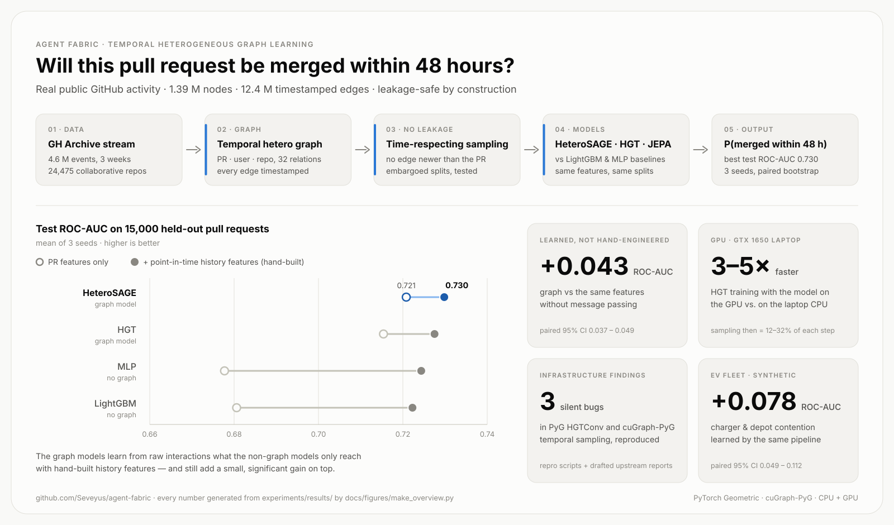
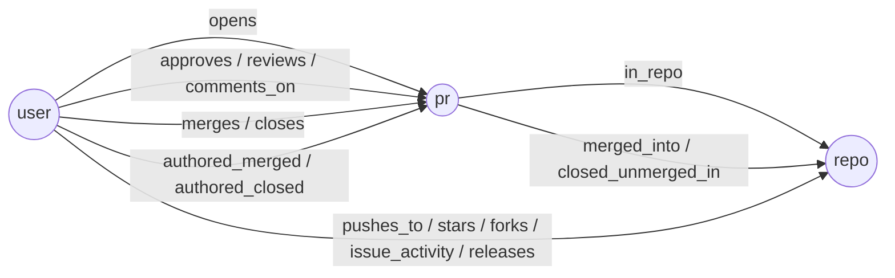
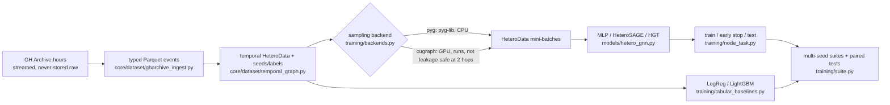

# Agent Fabric

Agent Fabric models software delivery as a **temporal heterogeneous graph**
(people, pull requests, repositories and the time-stamped interactions between
them) and asks whether graph learning predicts delivery outcomes better than
simpler models. The same pipeline is applied to a synthetic **EV-fleet
charging** problem to check that it carries over to industrial operations.

<picture>
  <source media="(prefers-color-scheme: dark)" srcset="docs/figures/agent_fabric_overview_dark.svg">
  
</picture>

<sub>Generated from `experiments/results/` by `docs/figures/make_overview.py` (PNG versions for slides: `docs/figures/*.png`).</sub>

The repository has two parts:

* **Graph-learning pipeline** (this README): GH Archive ingestion, a temporal
  heterogeneous graph with leakage-safe splits, PyG and cuGraph-PyG sampling
  backends, MLP / HeteroSAGE / HGT models, a temporal JEPA objective,
  baselines, benchmarks, tests.
* **Delivery-intelligence platform** (`apps/`, `core/services`, `db/`):
  FastAPI service, GitHub/Jira/Notion connectors, knowledge graph, pre-flight
  endpoint. Unchanged by this work; see [Platform](#platform).

Status of every component, with what is measured and what is not verified:
[docs/GRAPH_LEARNING.md §1](docs/GRAPH_LEARNING.md#1-status). Audit of the
starting point: [docs/AUDIT.md](docs/AUDIT.md).

## Contents

- [The prediction task](#the-prediction-task)
- [Graph schema](#graph-schema)
- [Pipeline](#pipeline)
- [Results](#results)
- [Self-supervised objective](#self-supervised-objective)
- [NVIDIA RAPIDS / cuGraph-PyG](#nvidia-rapids--cugraph-pyg)
- [Reproduce](#reproduce)
- [Limitations](#limitations)
- [Next steps](#next-steps)
- [Platform](#platform)

## The prediction task

> When a pull request is opened, will it be merged within 48 hours?

Data: public GitHub events from [GH Archive](https://www.gharchive.org/),
2025-08-25 → 2025-09-15 (all hours), restricted to the 24,475 repositories with
at least two distinct human PR authors in the first week. GitHub trimmed the
public event payloads in October 2025 (PR titles, authors, merge flags and
commit lists disappeared; measured, see [GRAPH_LEARNING §3](docs/GRAPH_LEARNING.md#3-data)),
so later data cannot support this task.

Why a graph: whether a PR lands plausibly depends on the author's track
record, the repository's habits and the reviewers' activity — context outside
the PR. The experiments test that against hand-built history features rather
than assuming it.

## Graph schema



Every edge carries the time of the interaction; every relation has a reverse
twin (32 edge types). PR nodes carry features known at open time, plus
optional point-in-time history aggregates (author's and repository's prior
merge record, computed strictly before the open time). User and repository
nodes are featureless on purpose: their state changes over time and is
reconstructed from the time-filtered neighbourhood.

**Leakage control** (each with a test): temporal neighbour sampling never
returns an edge newer than the seed PR's open time (so a PR never sees its own
merge or reviews); node features are point-in-time; train / validation / test
are split by time with an embargo so that every label of a split is resolved
before the next split starts.

## Pipeline



## Results

All numbers come from [`experiments/results/`](experiments/results/), CPU only
(Intel i5-11300H, 4 cores), mean ± std over 3 seeds, test split scored once
with the checkpoint chosen on validation.

### Real data — GH Archive, 48 h PR merge

1.39 M nodes (816 k PRs, 547 k users, 24 k repos), 12.4 M directed edges;
40 k / 15 k / 15 k train / validation / test PRs, 32 % positive.
[Full table](experiments/results/gh_pr_merge__main.md).

| Model | Test ROC-AUC, intrinsic features | + point-in-time history | Train s | Test PRs/s |
|---|---|---|---|---|
| LightGBM | 0.681 ± 0.000 | 0.722 ± 0.001 | 0.4 | ~1.1 M |
| MLP (same loop as the GNNs) | 0.678 ± 0.001 | 0.724 ± 0.001 | 5 | ~83 k |
| HeteroSAGE | **0.721 ± 0.002** | **0.730 ± 0.001** | 87 | ~5.6 k |
| HGT | 0.715 ± 0.002 | 0.728 ± 0.001 | 166 | ~3.0 k |

* The temporal graph recovers the history signal on its own: HeteroSAGE vs.
  MLP on intrinsic features, **+0.043 AUC** (paired 95 % CI [0.037, 0.049]) —
  the same lift hand-built history aggregates give LightGBM (+0.042).
* On top of those aggregates the graph adds a small, significant
  **+0.0075** (CI [0.004, 0.011]) over LightGBM; without any seed subsampling
  (91 k / 29 k / 25 k PRs) the gap is +0.0085 (CI [0.006, 0.011]).
* HGT does not beat the cheaper HeteroSAGE and trains ~1.9× slower.
* On CPU the GNN costs ~200× LightGBM's training time for that gain; a GBDT on
  point-in-time aggregates is the sensible default for this task today.

### Synthetic EV fleet — will a vehicle miss its departure energy target?

Synthetic depot simulator with shared depot/feeder power caps and charger
queues (not real fleet data). [Table](experiments/results/ev_fleet__main.md),
[write-up](docs/INDUSTRIAL_GRAPH_APPLICATIONS.md).

| Model | Test ROC-AUC, per-session features | + engineered contention aggregates |
|---|---|---|
| LightGBM | 0.835 ± 0.014 | **0.931 ± 0.003** |
| MLP | 0.791 ± 0.008 | 0.917 ± 0.004 |
| HeteroSAGE | **0.869 ± 0.008** | 0.926 ± 0.003 |
| HGT | 0.863 ± 0.016 | 0.919 ± 0.005 |

Same lesson as on GitHub data: the GNN learns the shared-resource contention
from structure (+0.078 over the MLP, CI [0.049, 0.113]), but an expert's five
aggregates plus LightGBM do as well (difference −0.004, CI [−0.021, +0.012]).

### Synthetic PR graph — pipeline sanity check

With a planted mechanism visible only through history, non-graph models are
at chance (0.51–0.53) and HGT / HeteroSAGE reach 0.70 / 0.69.
[Table](experiments/results/synthetic_pr_merge__main.md).

### Temporal JEPA (self-supervised pretraining)

| | Real GH graph | Synthetic PR graph |
|---|---|---|
| Linear probe: JEPA vs. random frozen encoder | 0.696 vs 0.651 (+0.044) | 0.633 vs 0.526 (+0.107) |
| Fine-tuned, 10 % labels: JEPA vs. scratch | 0.695 vs 0.691 (+0.004) | 0.631 vs 0.585 (+0.046) |
| Fine-tuned, 100 % labels: JEPA vs. scratch | 0.717 vs 0.715 (n.s.) | 0.632 vs 0.702 (−0.070) |

The representation is useful on its own (on real data a linear head on the
frozen encoder matches a supervised HGT trained on 10 % of the labels) and
helps with few labels; with all labels it is neutral on real data and hurts
on synthetic data. Tables: [real](experiments/results/gh_pr_merge__jepa.md),
[synthetic](experiments/results/synthetic_pr_merge__jepa.md).

## Self-supervised objective

A temporal node-level JEPA ([models/temporal_jepa.py](models/temporal_jepa.py)):
from a PR's neighbourhood at open time (online encoder), predict the EMA
target encoder's embedding of that PR's *future* interactions in (t, t+Δ]
(its own features masked, its past edges removed), with the predictor
conditioned on Δ ∈ {12, 24, 48} h. Context and target carry disjoint
information, so an encoder cannot minimise the loss by ignoring change — the
failure mode of a temporal BYOL. Details, what was verified (stop-gradient,
EMA, alignment, embargo), where it helps and where it does not:
[GRAPH_LEARNING §7](docs/GRAPH_LEARNING.md#7-self-supervised-objective-temporal-node-jepa).

## NVIDIA RAPIDS / cuGraph-PyG

`training/backends.py` has two interchangeable samplers behind one interface:

* `pyg` — `torch_geometric.loader.NeighborLoader` with edge-level temporal
  sampling in pyg-lib (CPU). **Measured.**
* `cugraph` — `cugraph_pyg.data.GraphStore` + WholeGraph `FeatureStore`
  (edge timestamps stored per edge type) and `cugraph_pyg.loader.NeighborLoader`
  (26.10) with GPU temporal sampling. **Runs on a GeForce GTX 1650 Max-Q** after
  seven workarounds (pip install without raft-dask/cudf, empty edge types,
  seed-row alignment, seeds-per-call estimate, …), but **2-hop temporal
  sampling is not leakage-safe**: ~0.7–0.9 % of sampled edges are newer than
  the seed and ~2 % of batches contain out-of-range indices. Not used for
  training; draft upstream report in
  [docs/upstream_issue_cugraph_pyg.md](docs/upstream_issue_cugraph_pyg.md).

Measured on that laptop (GH graph, 12.4 M edges):

| Configuration | Sampling seeds/s | HGT train seeds/s | Sampling share |
|---|---|---|---|
| PyG sampler + model on CPU | 46 k – 87 k | 1.4 k – 2.8 k | 2 – 10 % |
| PyG sampler (CPU) + model on GPU | 46 k – 97 k | 5.8 k – 13.4 k | 12 – 32 % |
| cuGraph sampler + model on GPU | 1.2 k – 5.1 k | 1.1 k – 3.9 k | 68 – 91 % |

Putting the model on the GPU speeds HGT up 3–5× and makes sampling the next
bottleneck. On this small GPU, though, cuGraph-PyG's heterogeneous temporal
sampler is slower than pyg-lib on four CPU cores (5.8× even with a whole epoch
per sampling call). This is one laptop GPU and one mid-size graph, not a
statement about datacenter GPUs. Details:
[GRAPH_LEARNING §8.1 and §11](docs/GRAPH_LEARNING.md#81-what-happened-on-a-real-gpu).

## Reproduce

```bash
python3.12 -m venv .venv && . .venv/bin/activate
pip install -r requirements/graph-cpu.txt        # torch 2.8 CPU, PyG 2.7, pyg-lib 0.5
pytest tests/ml -q                               # 59 tests, ~1-2 min; the 3 cuGraph tests are skipped without a GPU

# fast, self-contained (synthetic data, minutes)
python -m training.node_task --config configs/synthetic_pr_merge.toml
python -m training.node_task --config configs/ev_fleet.toml --set model.encoder='"sage"'

# everything in experiments/results/: streams ~60 GB from GH Archive (~75 min at
# 10 MB/s), then several hours of CPU for the suites; steps can be run one by one
bash experiments/reproduce.sh            # or: bash experiments/reproduce.sh gh bench
```

Any config value can be overridden: `--set section.key=value` (TOML syntax).
Runs write `config.json`, `metrics.jsonl`, `best.pt`, `results.json` and test
predictions under `runs/`. With the default `backend.num_workers = 1`, two runs
with the same seed give identical metrics (tested).

GPU path (NVIDIA GPU with compute capability ≥ 7.0, CUDA 12 driver; ~10 GB of
disk for `.venv-gpu`). Installs with uv, runs the cuGraph tests, the temporal
correctness check and the GPU benchmarks:

```bash
bash scripts/setup_gpu_env.sh
```

## Limitations

* **GPU evidence from one laptop.** GTX 1650 Max-Q, 4 GB. The cuGraph-PyG
  backend runs but is not leakage-safe at 2 hops, and was slower than CPU
  sampling there; all model results use the PyG sampler.
* **One window.** Three weeks of September 2025, one temporal test window,
  24,475 pre-selected repositories, subsampled seeds; stability over time is
  not measured.
* **Small graph gain.** Beyond engineered aggregates the GNN adds +0.005 to
  +0.0075 AUC at a large compute cost; HGT is not better than HeteroSAGE.
* **JEPA helps only with few labels.** The self-supervised encoder beats a
  random encoder under a linear probe and helps with 10 % of the labels
  (+0.004 on real data, +0.046 on synthetic), but gives nothing with all labels
  (and hurts on synthetic data; fine-tuning schedules were not tuned).
* **No temporal encoding beyond sampling** (PyG's HGTConv has no RTE), no
  calibration, no per-prediction explanations.
* **EV fleet is synthetic.** It shows the pipeline transfers, not that it
  works on a real fleet.

Full list: [GRAPH_LEARNING §12](docs/GRAPH_LEARNING.md#12-limitations-and-next-steps).

## Next steps

* File the cuGraph-PyG report and re-test 2-hop temporal sampling on a
  datacenter GPU and a larger graph, where GPU sampling is designed to pay off.
* Relative temporal encoding (HGT's RTE) or time-aware message functions, so
  recency matters beyond the sampling cut-off.
* Longer collection (several months before October 2025) and multiple test
  windows, to measure stability over time.
* Calibrated probabilities and per-prediction explanations before wiring a
  model into the pre-flight API.
* JEPA: target normalisation / variance terms and longer schedules; re-test
  the low-label regime with more seeds.

## Platform

The FastAPI service, worker and connectors predate this work and were not
modified. Run with `uvicorn apps.api.main:app --reload` (full dependencies:
`pip install -e .`; database and Qdrant via `make dev-up`). The pre-flight
endpoint (`POST /preflight`) traverses the stored causal graph and scores
consequences with **hand-set heuristics** (stored edge confidence × a fixed
multiplier per relation type); it does not use a learned model.

Example (heuristic scores, see above):

```bash
curl -X POST http://localhost:8000/preflight -H "Content-Type: application/json" \
  -d '{"action": "modify", "target_ref": "auth_middleware.py", "project_ref": "myorg/backend"}'
```

**Snapshot-level JEPA (original prototype).** `models/world_model.py` encodes
weekly per-repository snapshot graphs with HGT and predicts the latent of the
window k days later. It was repaired (it could not import or run, and its
predictor saw the target window's event summary) and is tested, but it has not
been trained on real data:

```bash
python -m training.train --pairs data/pairs_14d.pkl --epochs 50 --device cpu   # pairs: training.dataset.build_pairs_from_timelines
python -m training.evaluate --checkpoint checkpoints/last.pt --pairs data/pairs_14d.pkl   # scores the temporal hold-out
```

## References

- Hu et al., *Heterogeneous Graph Transformer*, 2020 — https://arxiv.org/abs/2003.01332
- Assran et al., *Self-Supervised Learning from Images with a Joint-Embedding Predictive Architecture*, 2023 — https://arxiv.org/abs/2301.08243
- Grill et al., *Bootstrap Your Own Latent*, 2020 — https://arxiv.org/abs/2006.07733
- Thakoor et al., *Large-Scale Representation Learning on Graphs via Bootstrapping (BGRL)*, 2021 — https://arxiv.org/abs/2102.06514
- PyG temporal sampling and cuGraph-PyG documentation — https://pytorch-geometric.readthedocs.io, https://docs.nvidia.com/cugraph/
